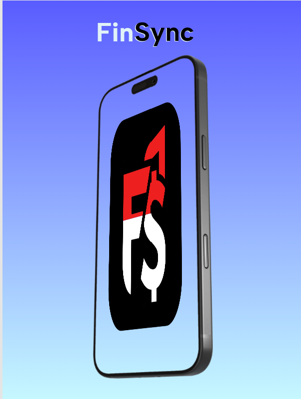
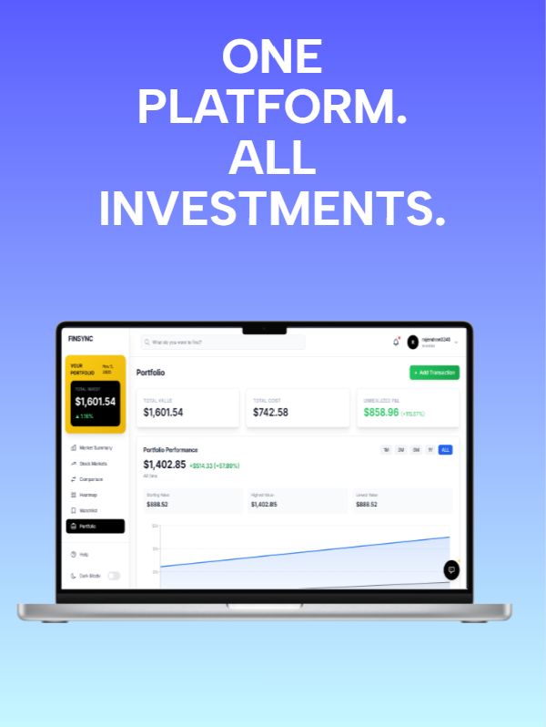
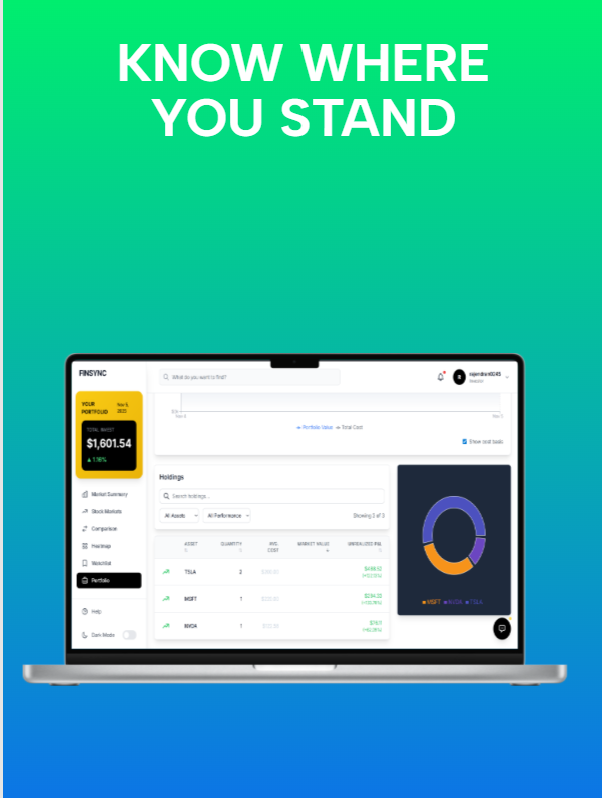
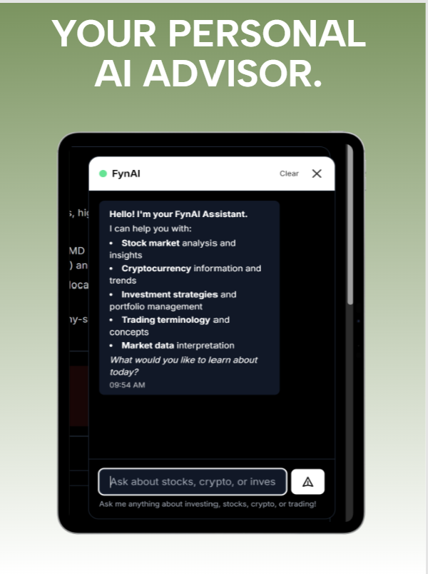
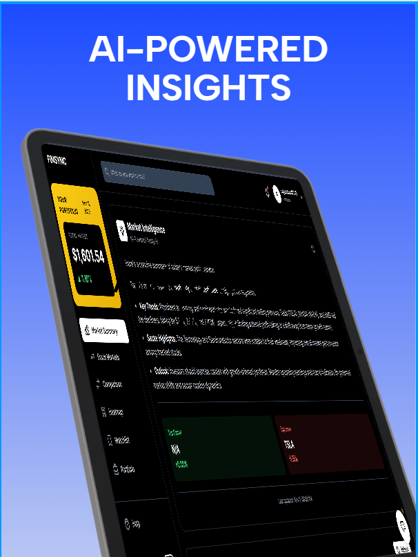
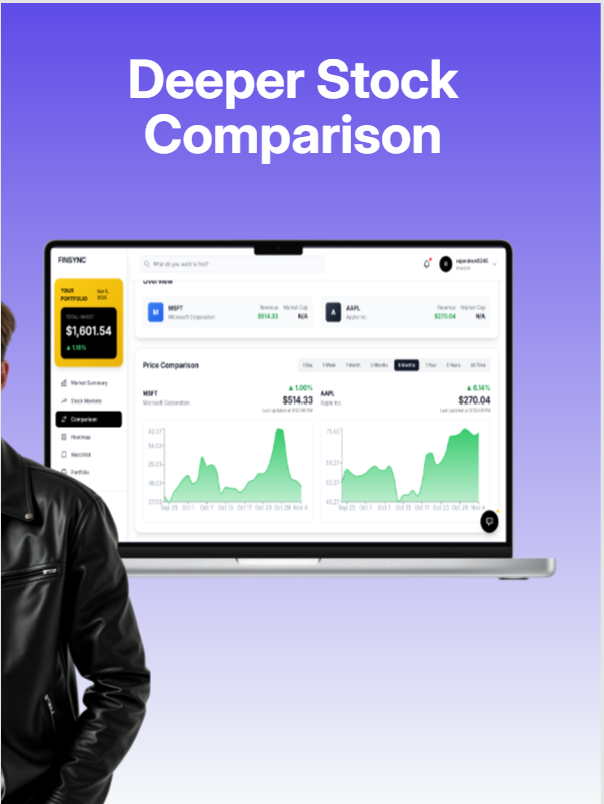

# FinSync - Investment Portfolio Tracker 

## Image Gallery

| Main Dashboard | Heatmap View | Portfolio Overview |
|----------------|--------------|--------------------|
|  |  |  |

| Watchlist | AI Assistant | Transactions Management |
|-----------|--------------|-------------------------|
|  |  |  |

| Market Data |
|-------------|
|  |


A modern, full-stack investment portfolio management platform for tracking stocks and cryptocurrency with real-time market data, AI-powered insights, and comprehensive analytics.


---

## 📑 Table of Contents

- [Features](#features)
  - [Portfolio Management](#portfolio-management)
  - [Data Visualization](#data-visualization)
  - [Watchlist](#watchlist)
  - [FynAI Assistant](#fynai-assistant)
  - [Search & Filter](#search--filter)
  - [Import/Export](#importexport)
  - [Authentication & Database](#authentication--database)
  - [User Experience](#user-experience)
- [Tech Stack](#tech-stack)
  - [Frontend](#frontend)
  - [Backend & Database](#backend--database)
  - [APIs & Services](#apis--services)
  - [State Management](#state-management)
- [Application Sections](#application-sections)
- [Installation & Setup](#installation--setup)
  - [Prerequisites](#prerequisites)
  - [Quick Start](#quick-start)
  - [Database Schema](#database-schema)
- [Build for Production](#build-for-production)
- [Deployment](#deployment)
  - [Deploy to Vercel (Recommended)](#deploy-to-vercel-recommended)
  - [Deploy to Netlify](#deploy-to-netlify)
  - [Other Platforms](#other-platforms)
- [Security](#security)
  - [Authentication](#authentication)
  - [Database Security](#database-security)
  - [Best Practices](#best-practices)
- [Project Structure](#project-structure)
- [License](#license)
- [Author](#author)
- [Acknowledgments](#acknowledgments)

---

## Features

### Portfolio Management
- **Real-time Portfolio Tracking** - Monitor stocks and crypto with live market data
- **P&L Calculations** - Automatic profit/loss tracking with percentage gains
- **Transaction Management** - Track buy/sell transactions across brokers
- **Holdings Overview** - Current positions with market values
- **Performance Charts** - Historical portfolio value over time
- **Asset Allocation** - Visual breakdown by stocks/crypto

### Data Visualization
- **Market Heatmap** - S&P 500 performance visualization
- **Interactive Charts** - Portfolio performance over time (1M, 3M, 6M, 1Y, ALL)
- **Allocation Pie Chart** - Asset distribution
- **Price Trends** - Historical data with Recharts


### Watchlist
- **Track Tickers** - Monitor stocks/crypto you're interested in
- **Price Alerts** - Set target prices with visual indicators
- **Alert Notifications** - "Target Hit!" when price reaches goal
- **Notes** - Add personal investment notes


### FynAI Assistant
- **Chat Interface** - Floating chatbot button
- **Gemini AI Powered** - Google's Gemini 2.5 Flash
- **Investment Focused** - Stocks, crypto, trading, market analysis
- **Markdown Formatting** - Rich text responses with tables and lists
- **Conversation History** - Maintains context
- **Search Integration** - Ask questions directly from search bar

### Search & Filter
- **Transaction Search** - Find by ticker, type, broker, date range
- **Holdings Sort** - Sort by value, P&L, quantity, ticker
- **Performance Filter** - Show only profitable or losing positions
- **Live Stats** - Real-time filtered results count

### Import/Export
- **CSV Export** - Download all transactions
- **CSV Import** - Bulk upload transactions
- **Sample Template** - Pre-formatted CSV template
- **Data Validation** - Error checking on import


### Authentication & Database
- **Supabase Auth** - Secure user authentication
- **PostgreSQL Database** - Cloud-synced data
- **Row Level Security** - Users only see their own data
- **Auto-sync** - Data synced across devices

### User Experience
- **Dark/Light Mode** - Theme toggle
- **Responsive Design** - Mobile, tablet, desktop
- **Modern UI** - TailwindCSS styling
- **Loading States** - Skeleton screens
- **Empty States** - Helpful messages


## Tech Stack

### Frontend
- **React 19** - UI framework
- **TypeScript** - Type safety
- **Vite** - Build tool
- **TailwindCSS** - Styling
- **Recharts** - Data visualization

### Backend & Database
- **Supabase** - Backend as a Service
- **PostgreSQL** - Relational database
- **Row Level Security** - Data protection
- **Real-time subscriptions** - Live updates

### APIs & Services
- **Google Gemini AI** - AI chatbot
- **Supabase Auth** - Authentication
- **Market Data** - Real-time prices

### State Management
- **React Context API** - Global state
- **Custom Hooks** - Reusable logic
- **LocalStorage** - Client-side cache

## Application Sections

### 1. Heatmap (Home)
- S&P 500 market visualization
- Color-coded performance
- Sector grouping

### 2. Portfolio
- Portfolio summary cards
- Performance chart (time range filters)
- Holdings table (sortable, filterable)
- Asset allocation chart

### 3. Transactions
- All buy/sell transactions
- Search & filter (ticker, type, broker, date)
- CSV import/export
- Transaction statistics

### 4. Watchlist
- Tracked tickers with current prices
- Price alert indicators
- Target price tracking
- Personal notes

### 5. Market Data
- Individual stock/crypto details
- Price charts
- News articles
- AI-powered analysis

### 6. AI Assistant (Floating)
- Chat interface
- Investment Q&A
- Market insights
- Trading terminology

## Installation & Setup

### Prerequisites
- Node.js (v18 or higher)
- npm or yarn
- Gemini API Key ([Get one free](https://aistudio.google.com/apikey))
- Supabase Account ([Sign up free](https://supabase.com))

### Quick Start

#### 1. Clone Repository
```bash
git clone https://github.com/YOUR_USERNAME/finsync-portfolio.git
cd finsync-portfolio
```

#### 2. Install Dependencies
```bash
npm install
```

#### 3. Set Up Supabase Database

**A. Create Supabase Project**
1. Go to [supabase.com](https://supabase.com)
2. Click "New Project"
3. Fill in project details
4. Wait 2-3 minutes for provisioning

**B. Run Database Schema**
1. Open Supabase Dashboard → SQL Editor
2. Click "New Query"
3. Copy entire `database.sql` file
4. Paste and click "Run"
5. Verify tables created in Table Editor

**C. Enable Authentication**
1. Go to Authentication → Providers
2. Enable Email provider

**D. Get API Credentials**
1. Go to Settings → API
2. Copy Project URL
3. Copy anon/public key

#### 4. Configure Environment Variables

Create `.env.local` in root directory:

```env
# Supabase Configuration
VITE_SUPABASE_URL=https://your-project.supabase.co
VITE_SUPABASE_ANON_KEY=your-anon-key-here

# Gemini AI API Key
GEMINI_API_KEY=your-gemini-api-key-here
```

#### 5. Start Development Server
```bash
npm run dev
```

#### 6. Open in Browser
Navigate to `http://localhost:5173`

### Database Schema

The app uses 5 main tables:

1. **profiles** - User profile information
2. **transactions** - All buy/sell transactions
3. **wishlist** - Watchlist items with price alerts
4. **user_preferences** - User settings (theme, currency, etc.)
5. **price_alerts** - Price alert conditions

**Security Features:**
- Row Level Security (RLS) enabled
- Users only see their own data
- Automatic profile creation on signup
- Password hashing by Supabase Auth

## Build for Production

```bash
npm run build
npm run preview
```

## Deployment

### Deploy to Vercel (Recommended)

1. **Connect Repository**
   - Go to [vercel.com](https://vercel.com)
   - Import your GitHub repository

2. **Configure Environment Variables**
   Add these in Vercel dashboard:
   ```
   VITE_SUPABASE_URL=your-supabase-url
   VITE_SUPABASE_ANON_KEY=your-anon-key
   GEMINI_API_KEY=your-gemini-key
   ```

3. **Deploy**
   - Click "Deploy"
   - Wait for build to complete
   - Your app is live!

### Deploy to Netlify

1. **Connect Repository**
2. **Build Settings**
   - Build command: `npm run build`
   - Publish directory: `dist`
3. **Environment Variables**
   - Add same variables as Vercel
4. **Deploy**

### Other Platforms
Works on any static hosting:
- GitHub Pages
- Cloudflare Pages
- AWS Amplify
- Firebase Hosting

## Security

### Authentication
- **Supabase Auth** - Industry-standard authentication
- **Password Hashing** - bcrypt encryption
- **JWT Tokens** - Secure session management

### Database Security
- **Row Level Security (RLS)** - Users only access their own data
- **PostgreSQL** - Enterprise-grade database
- **Automatic Backups** - Supabase handles backups
- **SSL Encryption** - All connections encrypted

### Best Practices
- Passwords never stored in application tables
- API keys in environment variables only
- RLS policies on all tables
- Input validation on all forms
- XSS and CSRF protection

## Project Structure

```
finsync-portfolio/
├── src/
│   ├── components/          # React components
│   ├── context/             # React Context
│   ├── hooks/               # Custom hooks
│   ├── lib/                 # Utilities
│   ├── services/            # API services
│   ├── types.ts             # TypeScript types
│   └── main.tsx             # Entry point
├── database.sql             # Database schema
├── .env.local               # Environment variables
└── package.json
```

## License

This project is licensed under the MIT License.

## Author

**Rajendran Kumarasamy**

- Portfolio: [rajenk.dev](https://rajenk.dev)
- LinkedIn: [Rajendran Kumarasamy](https://www.linkedin.com/in/rajendran-kumarasamy/)
- GitHub: [@rajen05](https://github.com/rajen05)
- Email: rajendrank.work@gmail.com

## Acknowledgments

Built with React, TypeScript, Supabase, and Google Gemini AI.

- **Supabase** - Backend and authentication
- **Google Gemini AI** - AI-powered assistant
- **Recharts** - Data visualization
- **TailwindCSS** - UI styling

---

**FinSync** - Professional Investment Portfolio Management
